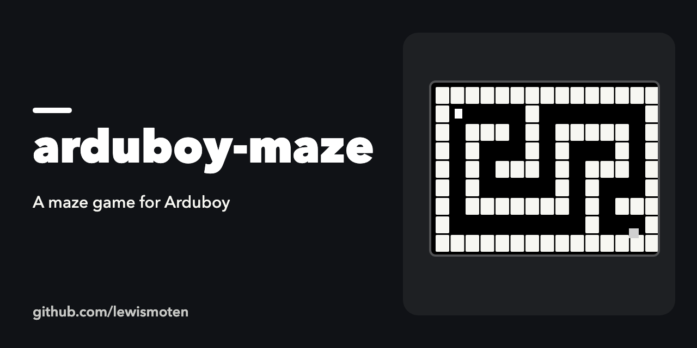

# arduboy-maze

A maze game for the [Arduboy](https://arduboy.com/) handheld, written as an Arduino sketch.

## Status

May 2016 experiment, unfinished. `arduboy-maze.ino` is the sketch, with a player (`player.cpp`) and simple rectangle geometry (`geometry.cpp`).

## Build

Open `arduboy-maze.ino` in the Arduino IDE with the Arduboy library installed, then upload it to an Arduboy.
